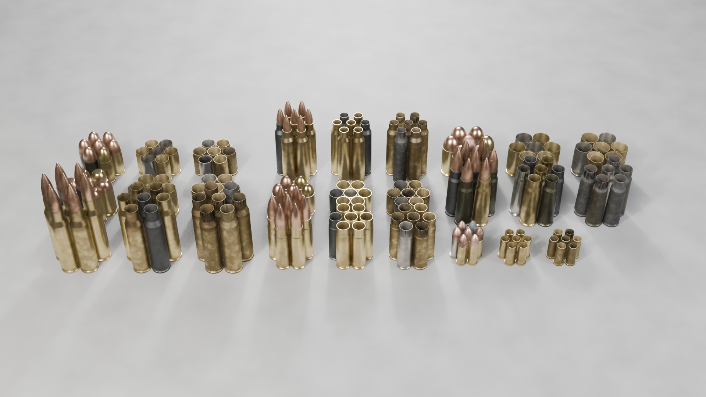
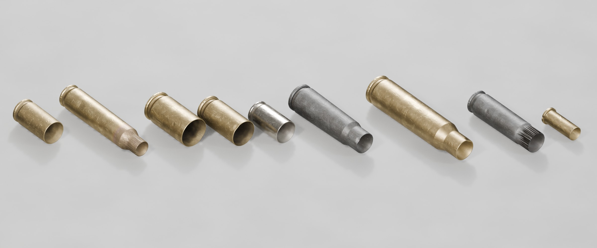

# gun-food

<p align="center">
  
  <br><sub>Hank Venture, <i>The Venture Bros.</i></sub>
</p>

Parametric 3D models of firearm cartridges for Blender, built to **SAAMI dimensions and
tolerances**, with procedural, physically based materials tuned for EEVEE. Every copy in a
scene is a different, seeded sample: dimensions drawn inside the manufacturing tolerances,
plus the small dents, out-of-round and runout that bulk-packed factory ammo picks up. Each
copy also comes from a "maker": commercial or military headstamps, brass, nickel, aluminium
or coated steel cases, coloured primer sealant, green-tipped M855-style bullets. Fired
brass comes expanded, struck, tarnished, scratched and sooty, the way it's picked up at the
range.

Built for synthetic training data (casing / caliber recognition) and for artists who want
correct proportions.






## What's included

| Key | Cartridge | Bullet | Source |
|---|---|---|---|
| `9mm` | 9mm Luger (9×19mm) | 115 gr FMJ RN | ANSI/SAAMI Z299.3 |
| `223` | .223 Remington | 55 gr FMJBT | ANSI/SAAMI Z299.4 |
| `45ACP` | .45 ACP | 230 gr FMJ RN | ANSI/SAAMI Z299.3 |
| `40CAL` | .40 S&W | 180 gr FMJ FP | ANSI/SAAMI Z299.3 |
| `380ACP` | .380 ACP | 95 gr FMJ RN | ANSI/SAAMI Z299.3 |
| `762x39` | 7.62×39mm | 123 gr FMJBT | ANSI/SAAMI Z299.4 |
| `308` | .308 Winchester | 150 gr FMJBT | ANSI/SAAMI Z299.4 |
| `300blackout` | .300 AAC Blackout | 125 gr FMJ (shared .308" bullet) | ANSI/SAAMI Z299.4 |
| `22LR` | .22 Long Rifle | 40 gr plated LRN | ANSI/SAAMI Z299.1 |

**[SPECS.md](SPECS.md)** lists every dimension with its tolerance, which values are
estimated, and where each came from. It's generated from the spec files, so it always
matches the models.

`cartridges.blend` holds every cartridge as three tightly packed groups of seven (loaded
rounds, new primed cases, fired cases) with 10 mm between groups. Each copy carries its
sampled values as custom properties (`case_length`, `oal`, `bullet_dia`, `condition`,
`maker`, `headstamp`, `case_metal`, `sealant`, `tip`, `age`, `wear`, `dirt`, `seed`, …),
handy as training labels.

## Blender add-on

The easiest way in. Get `gun_food-<version>.zip` from the repo's Releases (or build it:
`python tools/package_addon.py`, which writes it to `dist/`), then drag it into Blender, or
use Edit > Preferences > Get Extensions > ⌄ > Install from Disk. Needs Blender 4.2+.

A **Gun Food** tab appears in the 3D Viewport sidebar (N):

| Control | Does |
|---|---|
| Cartridge, Kind | any of the specs above, as a loaded round, new primed case or fired case |
| Count, Hex Cluster / Row | how many copies to place at the 3D cursor, and how |
| Random Seed / Seed | a new seed every time, or a fixed one to rebuild the same copies |
| Maker | Any (one per copy, weighted for the cartridge) or a fixed maker from `makers.toml` |
| Dirt, Soot, Age, Wear | scale the condition's dirt, (fired) soot, tarnish and scratches |
| **Add Cartridges** | places the copies, each a separate in-tolerance sample |
| **Re-roll Selected** | rebuilds the selected copies with new seeds, keeping their place, parent and collections |
| **Duplicate as New Variation** | copies the selection beside itself, each copy a new sample |
| **Add Catalog** | the full grouped layout of every cartridge, as `build.py` makes it |
| **Tune EEVEE for Small Parts** | the EEVEE settings below, on the current scene |
| Spec Overrides | change case length, base, mouth and rim diameters, rim thickness, loaded length and crimp; copies still vary inside the tolerances around the new values, and settings that can't be built are refused with the reason |

The add-on runs the same code as `build.py` and reads the same TOML specs (bundled in the
ZIP), so a cartridge added from the panel matches one from the command line.

## Build

Needs Blender 4.2 or newer (developed on 5.2). No other dependencies.

```sh
blender --background --factory-startup --python build.py -- --report docs/dimension_check.md
```

| Option | Does |
|---|---|
| `--seed N` | variation seed (default 1); the same seed rebuilds the same scene |
| `--only 9mm 308` | build only some cartridges |
| `--engine eevee` | `eevee` (default) or `cycles` |
| `--render DIR` | also render overview, side lineup, headstamp and fired close-up images |
| `--report PATH` | measure every copy against its tolerance band ([example](docs/dimension_check.md)) |
| `--out PATH` | where to write the .blend (default `cartridges.blend`) |
| `--cpu` | Cycles only: render on the CPU |

A full build takes about 3 minutes and makes ~12.7M vertices, most of them in the fine mesh
that carries the flat spots and scratches; the four preview images take about 50 s in EEVEE.
The .blend is about 425 MB, so it isn't kept in git: build it, or download it from the repo's
Releases.

## How it works

```
specs/*.toml, bullets/*.toml ──▶ specs.py      load, fill defaults, validate (pure Python)
                             ──▶ variation.py  seeded in-tolerance copies + handling damage
                             ──▶ profiles.py   2D half-profiles: case, crimp, primer, bullet
                             ──▶ blender/mesh.py       revolve, dent, stamp headstamps
                             ──▶ blender/materials.py  procedural metals (EEVEE-friendly)
                             ──▶ blender/scene.py      groups, studio, checks, renders
```

- **Tolerances.** Case and bullet values are SAAMI maximums with SAAMI's minus tolerances.
  Each copy samples inside those bands, clustered the way real lots are (new brass runs a
  little under max length), with body diameters sharing one "die" offset. Loaded length
  follows a typical factory length with a small spread, clamped to SAAMI's min/max.
- **Bullets** live in `bullets/` and are shared between cartridges: the .308 Winchester and
  .300 Blackout both take .308" bullets. Noses are tangent ogives with a rounded tip
  (folded FMJ jacket), a flat meplat (flat point) or, for pistol round noses, an elliptic
  nose that closes gradually to a blunt tip (`tip = "elliptic"`, `nose_power` sets how full);
  optional boat tail, cannelure, open
  lead base and heel (.22 LR).
- **Rims and extractor grooves** follow the SAAMI and C.I.P. drawings per cartridge: the
  rim's outer face, a 35° bevel inside the rim thickness (its length is the drawing's rim
  thickness minus rim land), the rim's flat front face, the groove bottom and a ramp up to
  the body at the cartridge's angle (25° on .223, 36° on .308, 48° on 7.62×39). The
  head-side edge is only broken (0.15 mm); the standards don't chamfer it.
- **Crimps.** Loaded pistol rounds get a taper crimp: a few hundredths of a millimetre,
  closing gradually over the top 3.5 to 4.5 mm like a crimp die's long taper (the case
  body itself tapers all the way from head to mouth); rifle rounds are roll-crimped into the
  bullet's cannelure, which sets their seating depth; the .22 LR is crimped onto its heel.
  Empty cases stay uncrimped.
- **Handling damage** (factory new, bulk packed): a few shallow dents, slight out-of-round
  toward the mouth, the odd dinged case mouth, bullet runout, softened edges, a light film
  of dust, and some factory toning: uneven tarnish and small dark water spots. One maker per
  cartridge is `pristine` (the Gun Food house brand): showroom-clean cases and bright bullets.
- **Micro relief:** every case and bullet gets a few microns of smooth, inward waviness
  (more within a millimetre of the mouth, rim and bullet tip and base, more on soft plated
  and lead bullets, more once fired), so reflections wobble slightly instead of looking
  machined, plus the odd small, sharp ding (about one in every new case or two, a few on
  fired brass) and little nicks in the rim's edge. It only goes inward, so measured
  diameters stay in their bands.
- **Flat spots and fine scratches** (pressed into the mesh): a great many tiny flat or
  slightly dished spots on the exposed bullet and the rim's edge, from magazine lips, feed
  ramps, extractors and other rounds in the box. They have ragged, stretched outlines and
  sizes skewed hard to the small end (half under about 0.6 mm across), with the odd medium
  knock as a ragged cluster and now and then a flattened tip (never pushing a round under
  SAAMI's minimum length). A few broad, barely-there flattenings (4-9 mm across, at most a
  few hundredths of a mm deep) bend the reflections on case bodies and bullets, and short
  shallow scratches run mostly along the case and bullet, some around them, some any which
  way. How many follows handling (wear and grime: most on surplus and fired brass, a few on
  ordinary new ammo, next to none on the pristine house brand) and size (counts were tuned
  per mm² on a 9mm; a bullet's spots shrink where it slims, so a rifle ogive isn't creased).
  Parts that carry them are lathed with a ~0.15 mm mesh all over (subdividing just the
  spots left seams that showed as facets). The finest groove that carries is about 0.2 mm
  wide, so these scratches show as soft streaks in the reflections; the crisp hairlines and
  pits are in the shader.
- **Grime and handling** (`grime` per maker, `gf_grime` on each part): a thin film of old
  grease, darker oxidation patches, thousands of tiny pits and hairline scratches running
  every which way. Convex edges (rims, mouths, headstamp lips, bullet bases; the baked
  `edge` attribute) rub bright, shed their dirt and collect the most dings. The `surplus`
  maker is rough old military 9mm with decades of storage on it; ordinary new ammo carries
  a little; the pristine house brand none.
- **Fired brass** (`fired` condition, modelled on range pickups): body and neck expanded
  toward the chamber, crimp gone, shoulder pushed slightly forward, a firing-pin crater in
  the primer (a crushed rim on rimfire), an extractor nick, mouths dented by the deflector
  and boots, tarnish that streaks along the case, scratches, charred interiors (heaviest at
  the bottom and lower walls, thinning toward the mouth; about one lot in five burns clean
  and leaves hardly any), blow-by soot on the neck and shoulder, and dust in the
  recesses. Add more conditions in `variation.CONDITIONS`.
- **Makers** (`makers.toml`): each copy draws one, weighted per cartridge. A maker sets the
  headstamp layout, case finish (brass, nickel, aluminium, grey polymer or green lacquer
  over steel), primer finish, primer sealant (purple, red, magenta, blue, green; a ring at
  the cup's edge, sometimes run over the face), a staked primer crimp ring or three stab
  marks, the annealing stain on rifle necks, the age range and, for loaded rounds, the
  jacket and tip paint. Pistol bullets come as drawn gilding-metal FMJ, brass-jacketed
  (as shiny as the case) or copper-plated; .22s plated or bare lead.
  Military 5.56 and 7.62 NATO lots carry `LC`, a two-digit year, the NATO circled cross and
  lot dots; Eastern-bloc 7.62×39 carries an arsenal code and year. See SPECS.md for the
  full table.
- **Headstamps** are real geometry, stamped in two layers (a shallow full letter and a deeper,
  thinner core) for soft letter walls, with each letter's position, angle, size and depth
  jittered like a hand-set bunter. Marks sit at clock positions, read the way real ones do,
  and are spaced at the letters' inner edge so neighbours never run together. Every glyph's
  grown or thinned outline is checked before it's used: font outlines offset at tight
  corners fold over themselves, and a folded cutter silently eats letters. Rimfire marks
  are raised.
- **Materials** are all instances of one shared node group, **`GF Metal`**: each finish
  (brass, gilding metal, copper, lead, nickel, steel, polymer-coated and lacquered steel,
  aluminium, tip paints) is a material holding just that group with its own inputs
  (reflectance, F82 edge tint, roughness, tarnish, oxide film, drawing marks, specks,
  micro-dents, annealing, coat, age response). Edit the group once and every metal
  follows; every copy of a part shares its metal's material. Files built by an older
  version get the new group and values the first time the add-on touches them.
- **Coated steel:** steel cases are phosphated steel under a thin tinted clear coat, a dull
  grey polymer or a glossier olive lacquer. The steel's sheen shows through; the coat has
  its own orange-peel and mottling, and scratches cut through it to bright steel.
- **Finishes:** bright nickel plating is very shiny but satin, and barely tarnishes
  (`Age Response` 0.35). Bullets tarnish by jacket: brass jackets stay bright, gilding metal runs from
  bright to dull, plated copper is matte and soft from the start.
- **Layered, not blended.** Inside the group, metal, sealant and soil are complete BSDFs
  mixed as shader closures, like Unreal Substrate slabs: the masks only set coverage, so
  mask edges never turn into half-metallic brass with a pale outline. The soil has its own
  grain bump. Soot stays inside the metal layer (its colour and edge tint go to carbon
  black and it turns rough): EEVEE evaluates only a few closures per pixel and dropped a
  partial soot layer. Compile time is the group's real cost: the GPU compiler inlines every
  noise texture many times over, and Bump compiles its height graph three times, so the
  group reuses its noise textures' spare outputs and uses 3D noise (half the code of 4D).
- **Per-copy drivers** are baked into vertex attributes (`cavity` for recesses instead of
  costly ambient occlusion, `interior`, `zn` height along the case, `anneal` band, `rn`
  primer radius) or set on the object: the object colour (R dirt, G soot inside, B soot
  outside, A annealing) and the properties `gf_age` (tarnish; bullets carry their own),
  `gf_wear` (scratches), `gf_grime` (grease, oxidation, micro-dings), `gf_iris` (heat
  tint) and,
  on primers, `gf_seal` (sealant colour) and `gf_smear`. EEVEE reads these as uniforms
  (at most 8 per material, so they're kept few). Change them on an object to make it
  cleaner, older or filthier.
- **Age and wear.** Water spots come first, then tarnish spreads from blotches into
  streaks along the case and darkens with age; scratches run along the case and show bright
  through tarnish and dirt; the annealing stain darkens the neck and shoulder to a deep
  bronze and fades through darkened gold into the body. Some military lots instead show heat tint (`anneal_colour = rainbow`
  in `makers.toml`, `gf_iris` on the case): faint temper colours, straw and gold through
  bronze and purple up to a dark violet-bronze neck.
- **EEVEE setup:** screen-space ray tracing with a 2 mm trace thickness (the 0.2 m default
  smears copper beside millimetre-sized parts), shadows, no fast GI. The world's lower half
  stands in for the lit floor in reflections, so mirror-bright nickel doesn't go black. The
  ground sits 0.1 mm below the parts so heads and labels don't z-fight with it. Detail shots use a long
  lens instead of an orthographic camera, which also breaks screen-space reflections.

## Adding or changing a cartridge

1. Copy a similar file in `specs/` (straight-walled pistol: `9mm.toml`; bottleneck rifle:
   `223.toml`; rimfire: `22LR.toml`) and edit the numbers, keeping SAAMI's tolerances in the
   `*_tol` fields. Field names follow the drawings; `cartridges/specs.py` documents every
   field and default.
2. Point `[loaded] bullet` at a file in `bullets/`, or add one.
3. List anything you estimated in `approx = [...]` and fill in `[sources]`.
4. Run the checks and regenerate the docs:

   ```sh
   python tests/test_specs_and_profiles.py
   python tools/gen_specs_md.py
   blender --background --factory-startup --python tests/test_headstamps.py   # every maker's headstamp stamps cleanly, ~20 s
   blender --background --factory-startup --python tests/test_addon.py   # add-on smoke test, ~50 s
   ```

The loader rejects specs that can't be built (a bullet seated past the web, a loaded length
outside SAAMI's limits, a neck wider than the shoulder) with a message saying what to fix.

## Accuracy

- Case, bullet-diameter and loaded-length limits come from the current ANSI/SAAMI standards
  (Z299.1-2026 rimfire, Z299.3-2022 pistol, Z299.4-2025 rifle). Values not in a standard are
  marked ≈ in SPECS.md.
- Bullet shapes, wall thickness, crimp amounts, primer seating and the spread of values
  inside each tolerance band are typical values, the spread inferred from reloading-forum
  lot measurements.
- `build.py --report` measures every generated copy against its band.
- Standards are cited by link and only the individual dimensions are used; their drawings
  and data sheets aren't reproduced.
- These are visual models. Don't use them as reloading or chamber data.

## Headstamps

Commercial maker marks are made up (`CMX`, `GUN FOOD`, `K V A`, `SEVER`, `ZM`, rimfire `M`
and `G`); `LC` is the US Army's Lake City plant, and the 7.62×39 arsenal codes are factory
numbers, not brands. The caliber text follows real practice (`223 REM`, `45 AUTO`, …) and
lives in each spec's `[headstamp]`. Add your own makers, or change the weights, in
`makers.toml`; the loader checks every field and names what's wrong.

## Roadmap

- Fired cases: ejector marks, chamber scuffs, off-centre strikes, split necks, crushed cases;
  scattered (lying) layouts for field scenes
- Berdan primers and bimetal (copper-washed steel) jackets for steel-cased ammo
- More bullet types: hollow point, soft point, polymer tip, lead round nose, wadcutter
- More cartridges

## License

MIT, see [LICENSE](LICENSE).
