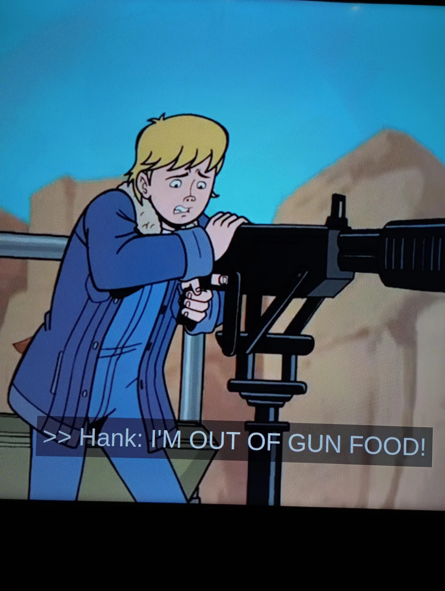
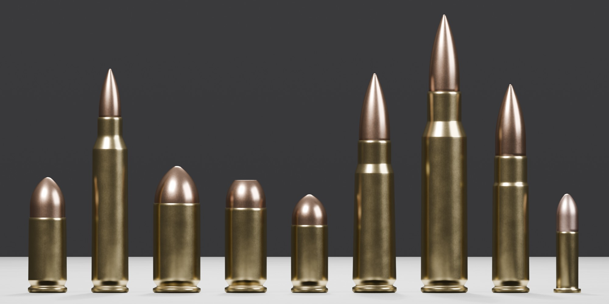
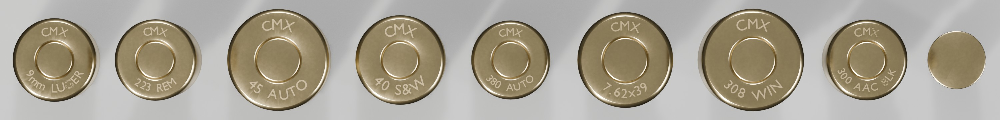

# gun-food

<p align="center">
  
  <br><sub>Hank Venture, <i>The Venture Bros.</i></sub>
</p>

Parametric 3D models of firearm cartridges for Blender, built to **SAAMI dimensions and
tolerances**, with procedural, physically based materials tuned for EEVEE. Every copy in a
scene is a different, seeded sample: dimensions drawn inside the manufacturing tolerances,
plus the small dents, out-of-round and runout that bulk-packed factory ammo picks up. Fired
brass comes expanded, struck, sooty and dirty, the way it's found on the ground.

Built for synthetic training data (casing / caliber recognition) and for artists who want
correct proportions.







## What's included

| Key | Cartridge | Bullet | Source |
|---|---|---|---|
| `9mm` | 9mm Luger (9×19mm) | 115 gr FMJ RN | ANSI/SAAMI Z299.3 |
| `223` | .223 Remington | 55 gr FMJBT | ANSI/SAAMI Z299.4 |
| `45ACP` | .45 ACP | 230 gr FMJ RN | ANSI/SAAMI Z299.3 |
| `40CAL` | .40 S&W | 180 gr FMJ FP | ANSI/SAAMI Z299.3 |
| `380ACP` | .380 ACP | 95 gr FMJ RN | ANSI/SAAMI Z299.3 |
| `762x39` | 7.62×39mm | 123 gr FMJBT | ANSI/SAAMI Z299.4 |
| `308` | .308 Winchester | 150 gr FMJBT | ANSI/SAAMI Z299.4 |
| `300blackout` | .300 AAC Blackout | 125 gr FMJ (shared .308" bullet) | ANSI/SAAMI Z299.4 |
| `22LR` | .22 Long Rifle | 40 gr plated LRN | ANSI/SAAMI Z299.1 |

**[SPECS.md](SPECS.md)** lists every dimension with its tolerance, which values are
estimated, and where each came from. It's generated from the spec files, so it always
matches the models.

`cartridges.blend` holds every cartridge as three tightly packed groups of seven (loaded
rounds, new primed cases, fired cases) with 10 mm between groups. Each copy carries its
sampled values as custom properties (`case_length`, `oal`, `bullet_dia`, `condition`,
`dirt`, `seed`, …), handy as training labels.

## Build

Needs Blender 4.2 or newer (developed on 5.2). No other dependencies.

```sh
blender --background --factory-startup --python build.py -- --report docs/dimension_check.md
```

| Option | Does |
|---|---|
| `--seed N` | variation seed (default 1); the same seed rebuilds the same scene |
| `--only 9mm 308` | build only some cartridges |
| `--engine eevee` | `eevee` (default) or `cycles` |
| `--render DIR` | also render overview, side lineup, headstamp and fired close-up images |
| `--report PATH` | measure every copy against its tolerance band ([example](docs/dimension_check.md)) |
| `--out PATH` | where to write the .blend (default `cartridges.blend`) |
| `--cpu` | Cycles only: render on the CPU |

A full build takes about 30 s and makes ~1.7M vertices; the four preview images take about
20 s in EEVEE. The .blend is about 60 MB, so it isn't kept in git: build it, or download it
from the repo's Releases.

## How it works

```
specs/*.toml, bullets/*.toml ──▶ specs.py      load, fill defaults, validate (pure Python)
                             ──▶ variation.py  seeded in-tolerance copies + handling damage
                             ──▶ profiles.py   2D half-profiles: case, crimp, primer, bullet
                             ──▶ blender/mesh.py       revolve, dent, stamp headstamps
                             ──▶ blender/materials.py  procedural metals (EEVEE-friendly)
                             ──▶ blender/scene.py      groups, studio, checks, renders
```

- **Tolerances.** Case and bullet values are SAAMI maximums with SAAMI's minus tolerances.
  Each copy samples inside those bands, clustered the way real lots are (new brass runs a
  little under max length), with body diameters sharing one "die" offset. Loaded length
  follows a typical factory length with a small spread, clamped to SAAMI's min/max.
- **Bullets** live in `bullets/` and are shared between cartridges: the .308 Winchester and
  .300 Blackout both take .308" bullets. Noses are tangent ogives with a rounded tip
  (folded FMJ jacket) or a flat meplat (flat point); optional boat tail, cannelure, open
  lead base and heel (.22 LR).
- **Crimps.** Loaded pistol rounds get a taper crimp; rifle rounds are roll-crimped into the
  bullet's cannelure, which sets their seating depth; the .22 LR is crimped onto its heel.
  Empty cases stay uncrimped.
- **Handling damage** (factory new, bulk packed): a few shallow dents, slight out-of-round
  toward the mouth, the odd dinged case mouth, bullet runout, softened edges, a light film
  of dust.
- **Fired brass** (`fired` condition): body and neck expanded toward the chamber, crimp
  gone, shoulder pushed slightly forward, a firing-pin crater in the primer (a crushed rim
  on rimfire), an extractor nick, bigger dents and dinged mouths from rocks and boots,
  charred interiors (heaviest at the bottom by the flash hole), blow-by soot on the neck,
  and patchy soil caked into the recesses. Add more conditions in `variation.CONDITIONS`.
- **Headstamps** are real geometry, stamped in two layers (a shallow full letter and a deeper,
  thinner core) for soft, rounded letter walls, with each letter's position, angle, size and
  depth jittered like a hand-set bunter. Rimfire marks are raised.
- **Materials** share one node graph per metal (brass, gilding metal, copper, lead, nickel,
  steel, aluminium): measured reflectance, F82 edge tint, tarnish, drawing marks, sparse
  dings and micro-dents, plus dirt and soot layers. Everything a copy needs is either baked
  into vertex attributes (`cavity` for recesses instead of costly ambient occlusion,
  `interior`, `zn` height along the case, `anneal` band) or packed into the object colour
  (R dirt, G soot inside, B soot outside, A annealing tint), which EEVEE reads as a plain
  uniform. Set an object's colour to make it cleaner or filthier.
- **EEVEE setup:** screen-space ray tracing with a 2 mm trace thickness (the 0.2 m default
  smears copper beside millimetre-sized parts), shadows, no fast GI. Detail shots use a long
  lens instead of an orthographic camera, which also breaks screen-space reflections.

## Adding or changing a cartridge

1. Copy a similar file in `specs/` (straight-walled pistol: `9mm.toml`; bottleneck rifle:
   `223.toml`; rimfire: `22LR.toml`) and edit the numbers, keeping SAAMI's tolerances in the
   `*_tol` fields. Field names follow the drawings; `cartridges/specs.py` documents every
   field and default.
2. Point `[loaded] bullet` at a file in `bullets/`, or add one.
3. List anything you estimated in `approx = [...]` and fill in `[sources]`.
4. Run the checks and regenerate the docs:

   ```sh
   python tests/test_specs_and_profiles.py
   python tools/gen_specs_md.py
   ```

The loader rejects specs that can't be built (a bullet seated past the web, a loaded length
outside SAAMI's limits, a neck wider than the shoulder) with a message saying what to fix.

## Accuracy

- Case, bullet-diameter and loaded-length limits come from the current ANSI/SAAMI standards
  (Z299.1-2026 rimfire, Z299.3-2022 pistol, Z299.4-2025 rifle). Values not in a standard are
  marked ≈ in SPECS.md.
- Bullet shapes, wall thickness, crimp amounts, primer seating and the spread of values
  inside each tolerance band are typical values, the spread inferred from reloading-forum
  lot measurements.
- `build.py --report` measures every generated copy against its band.
- Standards are cited by link and only the individual dimensions are used; their drawings
  and data sheets aren't reproduced.
- These are visual models. Don't use them as reloading or chamber data.

## Headstamps

Maker marks are the placeholder `CMX` (and `M` on rimfire). The caliber text follows real
practice (`223 REM`, `45 AUTO`, …). Change `[headstamp]` in a spec to use your own.

## Roadmap

- Fired cases: ejector marks, chamber scuffs, off-centre strikes, split necks, crushed cases;
  scattered (lying) layouts for field scenes
- Case variations: steel (lacquered and polymer coated), aluminium, nickel plated
- More bullet types: hollow point, soft point, polymer tip, lead round nose, wadcutter
- More cartridges, and a Blender add-on panel to build and re-roll copies without the
  command line

## License

MIT, see [LICENSE](LICENSE).
